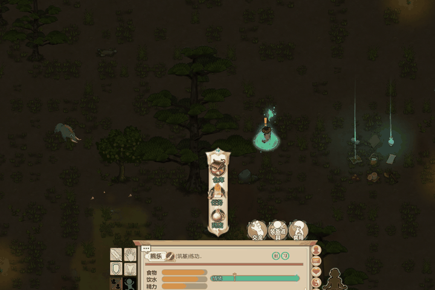
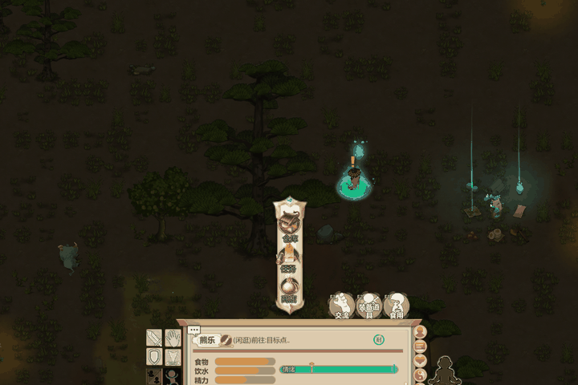
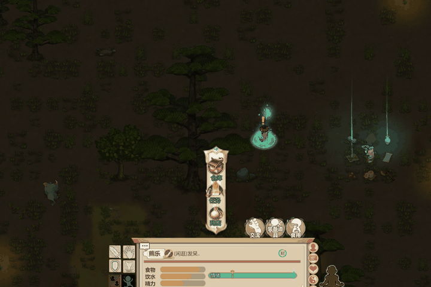
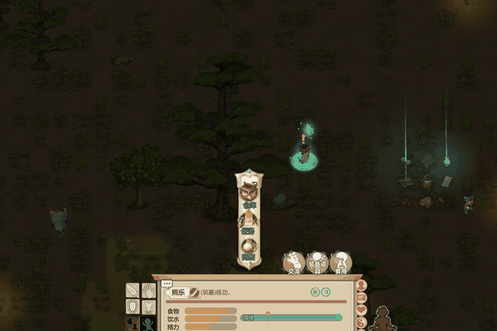

# amazing_shusame — 九霄流光訣

《了不起的修仙模擬器》Mod：新增功法《九霄流光訣》，**煉氣期**就能習得四道神通。
所有視覺特效都是自製的，**沒有使用任何遊戲內建特效**：貼圖由 Python 程式產生，再透過 Lua 直接操作 Unity 畫出來。

| 神通 | 效果 | 預覽 |
|---|---|---|
| 朱雀焚天 | 火焰粒子凝成的朱雀振翅撲向敵人，撞擊後炸出火球、火環、濃煙與餘火 |  |
| 流光劍雨 | 七柄光劍在頭頂排成扇形，依序射出，帶殘影與拖尾，最後一劍斬出金色十字 |  |
| 寒月冰蓮 | 雙層冰蓮在弟子腳下綻放旋轉，寒霧繚繞，花瓣四散時令其心境清明 |  |
| 紫霄雷印 | 雷印法陣成形、雷氣內聚，三道天雷劈落，電花四濺 |  |

## 安裝

1. 把整個資料夾放到 `遊戲目錄/Mods/JiuXiaoLiuGuang/`
2. 主選單「模组商店」旁的齒輪 → 勾選「九霄流光訣（自製特效）」
3. 讀檔

## 快捷鍵

| 按鍵 | 作用 |
|---|---|
| 左 Shift + 6 / 7 / 8 / 9 | 在選中的角色身上預覽：朱雀焚天 / 流光劍雨 / 寒月冰蓮 / 紫霄雷印（純畫面，不造成傷害） |
| 左 Shift + 0 | 讓選中的弟子解鎖《九霄流光訣》 |

也可以在開局時選擇角色經歷「九霄傳承」直接取得功法。

## 不開遊戲預覽特效

雙擊 `開啟特效預覽器.bat`（需要安裝 Python），瀏覽器會打開預覽器。
預覽器在網頁裡用 Lua 直譯器（fengari）**執行與遊戲完全相同的特效程式碼**，並用 WebGL 模擬 Unity 的繪製方式，所以改完程式按「重新讀取程式」就能馬上看到結果。

網址參數 `?fx=phoenix&t=1.3` 會播到第 1.3 秒後停格，方便截圖比對（`fx` 可為 `phoenix`、`sword`、`lotus`、`thunder`）。

## 特效原理

1. **貼圖**：`Tools/make_textures.py`、`Tools/make_flipbooks.py` 用 numpy 算出光暈、光劍、花瓣、符文法陣，以及火焰與煙霧的 4×4 序列幀。全部是白色加透明度，進遊戲再上色。
2. **Sprite 層**（`Scripts/JXLG_VFX.lua`）：Lua 透過 xLua 直接建立 Unity 的 `SpriteRenderer` / `LineRenderer`，搭配物件池、緩動函數與時間軸排程。閃電是用「中點位移」演算法即時生成。
3. **粒子層**（`Scripts/JXLG_PS.lua`）：用 Unity 原生 `ParticleSystem`，Lua 透過 `Emit(EmitParams)` 逐顆指定位置與速度，序列幀、亂流、拖尾、拉長火花由引擎原生模擬。
4. **效果編排**（`Scripts/JXLG_Effects.lua`、`Scripts/JXLG_Phoenix.lua`）：朱雀是由約 150 個骨架點組成（身體、五根飛羽的翅膀、三條尾羽），每一幀從每個點噴出短命的火焰粒子。

## 目錄

```
Info.json                 Mod 入口
Scripts/                  Lua：特效引擎、粒子、四個特效、神通邏輯、開發橋接
Settings/                 XML：功法、技能樹、秘術、神通、傷害、狀態、開局經歷
Tex/                      產生好的貼圖
Tools/                    貼圖產生腳本、離線預覽器
Preview/                  遊戲內實錄 GIF、預覽器背景
```

## 開發橋接

在 Mod 資料夾內建立 `Dev/` 目錄後，遊戲會每 0.3 秒檢查 `Dev/cmd.lua`，有的話就執行並刪除，可用來熱重載腳本、播放特效、截圖。一般遊玩不需要 `Dev/`，沒有這個目錄時橋接不會啟動。
